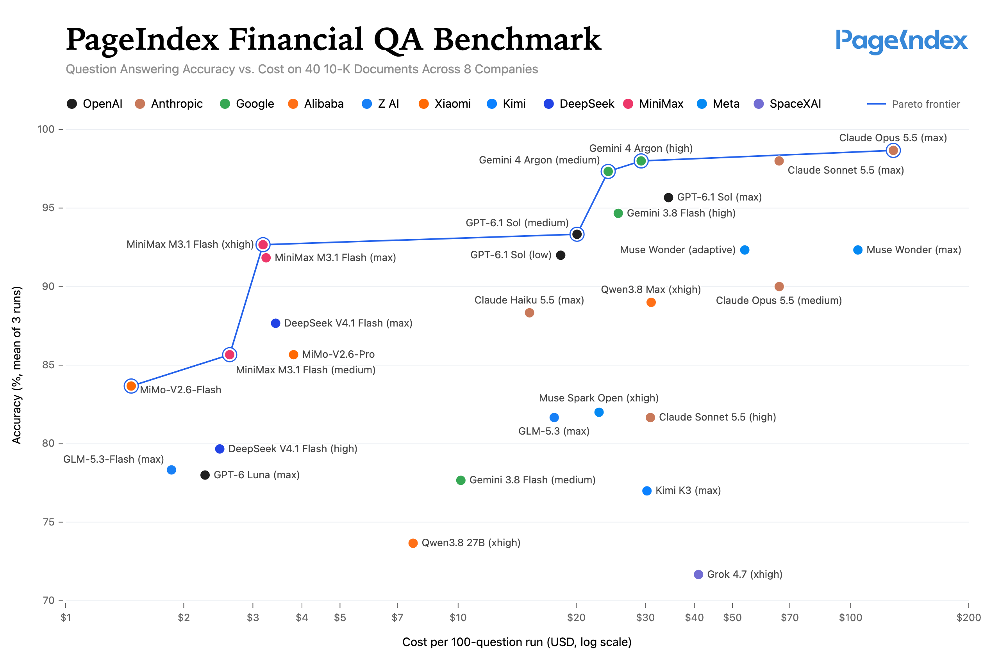

# PageIndex Benchmarks

Benchmarks run with [PageIndex](https://github.com/VectifyAI/PageIndex), with what is needed to recompute their
results: questions, code, every answer and model call, bills and grades. Each folder is one benchmark and stands on
its own.

Each benchmark has a `README.md` with its results and how to reproduce them, a `METHOD.md`, the data in `data/` and
the generated tables and charts in `results/`.

## Financial QA

Accuracy vs. cost of 34 configurations of 19 LLMs answering 100 questions over 40 Form 10-K filings
from 8 companies, with PageIndex doing the retrieval.

[Results, methodology and reproduction instructions →](financial-qa/README.md)
