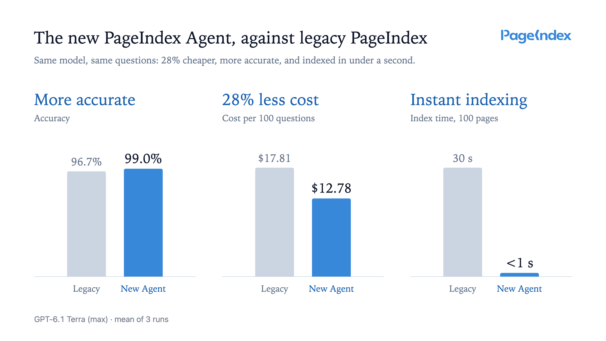
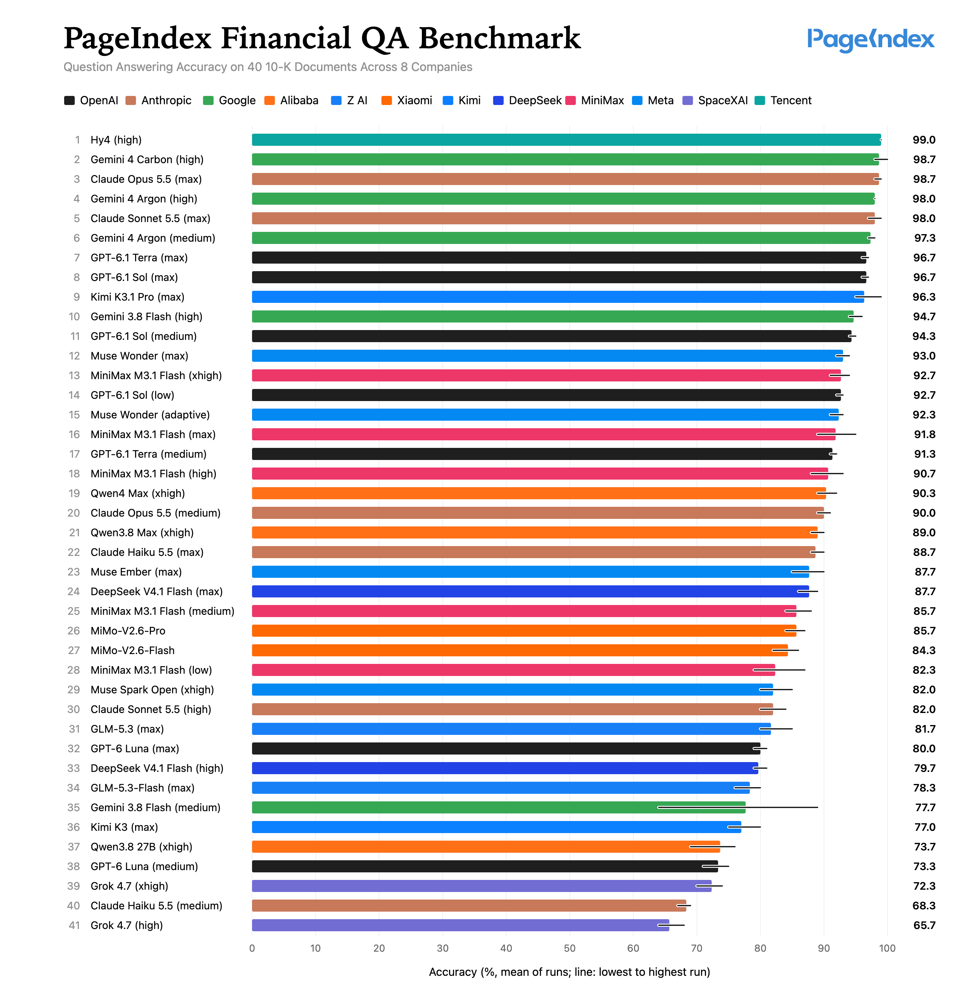
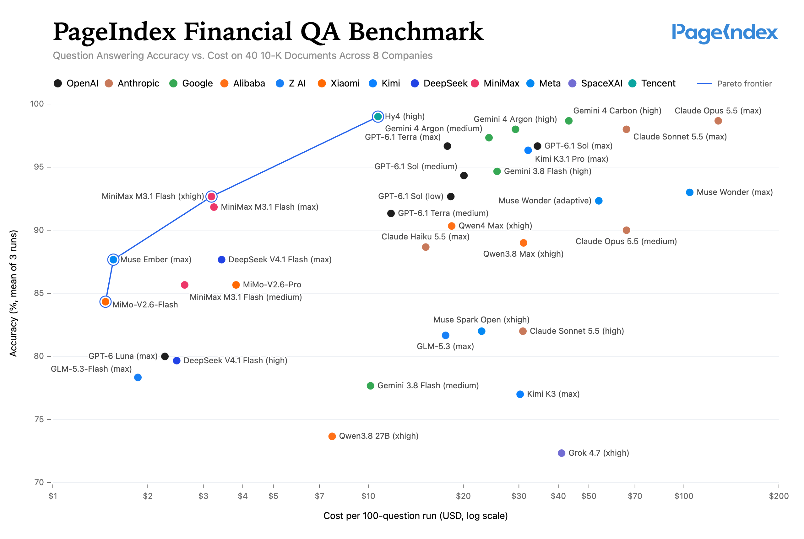

# PageIndex Benchmarks

Benchmarks run with [PageIndex](https://github.com/VectifyAI/PageIndex), with what is needed to recompute their
results: questions, code, every answer and model call, bills and grades. Each folder is one benchmark.

Each benchmark has a `README.md` with its results and how to reproduce them, a `METHOD.md`, the data in `data/` and
the generated tables and charts in `results/`.

## New Financial QA Results

The new PageIndex Agent against legacy PageIndex, with the same model on Financial QA's 100 questions: GPT-6.1 Terra
(max) answers 99.0%, up from 96.7%, at 28% less cost.

[Results, methodology and reproduction instructions →](new-agent-vs-legacy/README.md)

## Legacy Financial QA Results

Accuracy vs. cost of 41 configurations of 25 LLMs answering 100 questions over 40 Form 10-K filings
from 8 companies, with PageIndex doing the retrieval.

**Accuracy**

**Accuracy vs. cost**

[Results, methodology and reproduction instructions →](financial-qa/README.md)
