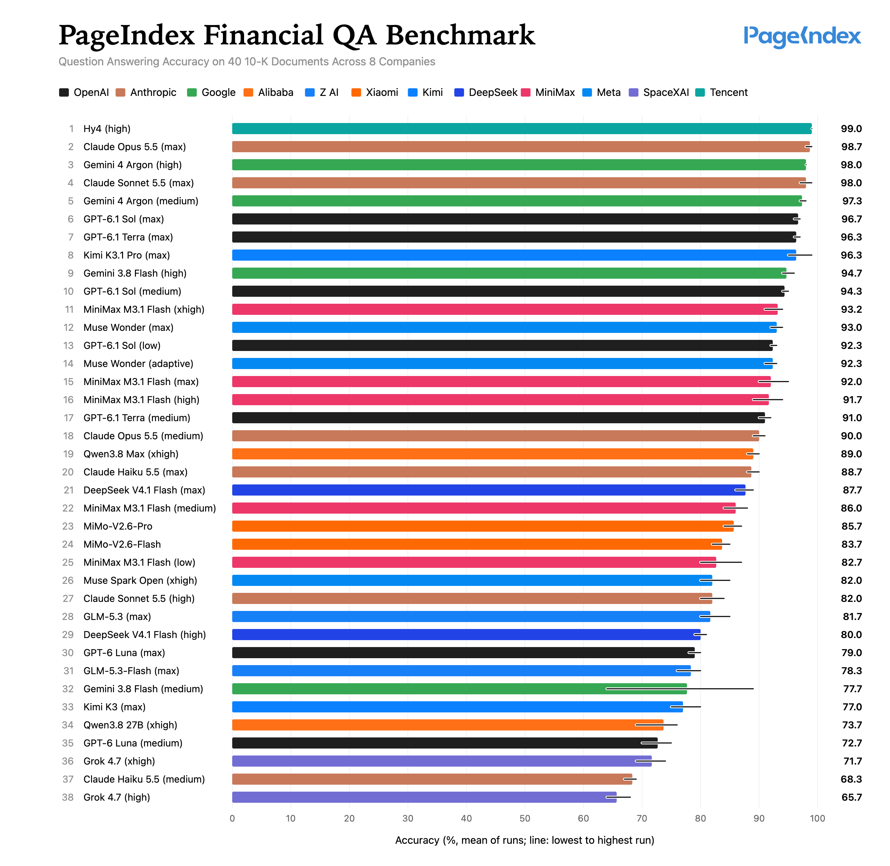
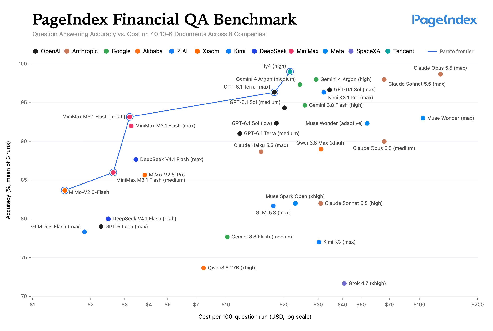
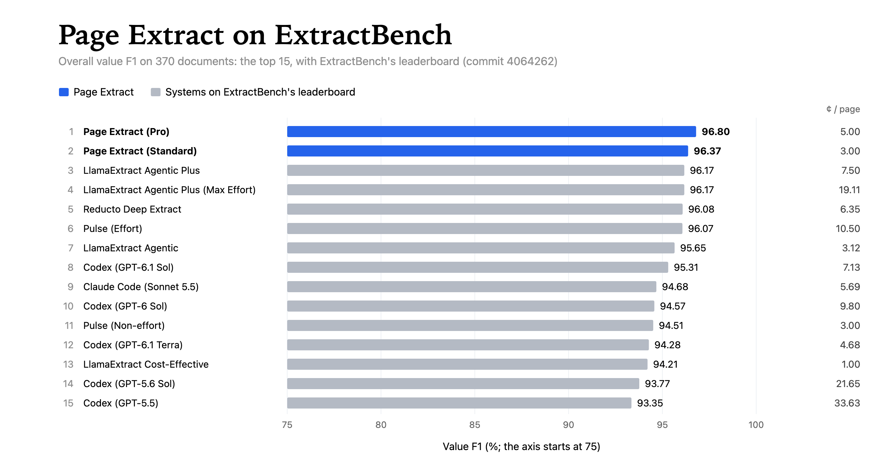

# PageIndex Benchmarks

Benchmarks run with [PageIndex](https://github.com/VectifyAI/PageIndex) and its APIs, with what is needed to check
their results. Each folder is one benchmark and stands on its own.

Each benchmark has a `README.md` with its results and how to reproduce them, the data in `data/` and the generated
tables and charts in `results/`.

## Financial QA

Accuracy vs. cost of 38 configurations of 22 LLMs answering 100 questions over 40 Form 10-K filings
from 8 companies, with PageIndex doing the retrieval.

**Accuracy**

**Accuracy vs. cost**

[Results, methodology and reproduction instructions →](financial-qa/README.md)

## Page Extract on ExtractBench

Page Extract, PageIndex's JSON-Schema extraction API, on ExtractBench's 370 documents (4,869 pages), scored with
ExtractBench's own scorer: 96.80 value F1 at the Pro tier (5¢ a page) and 96.37 at Standard (3¢ a page), both above
every system on ExtractBench's leaderboard.

**Overall value F1, beside ExtractBench's leaderboard**

[Results, how they were made, and how to run them again through the API →](extractbench/README.md)
