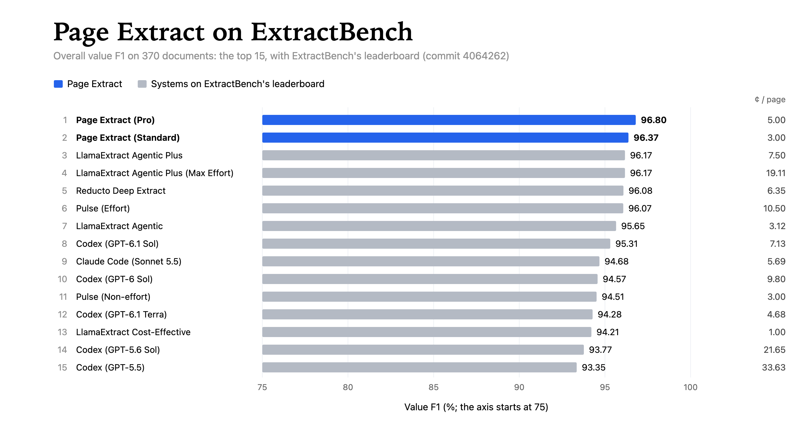
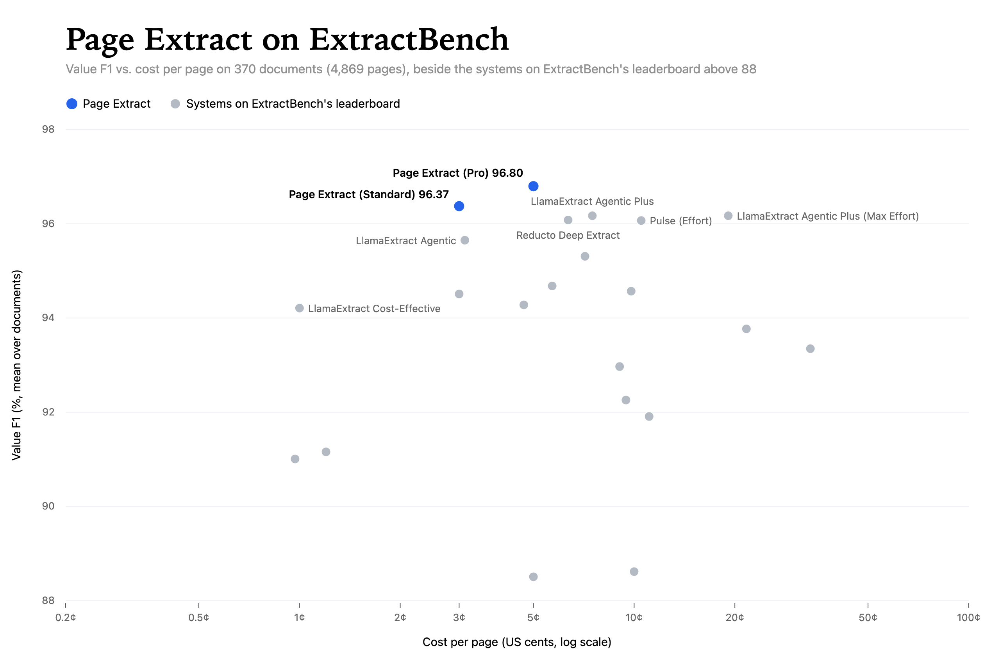

# Page Extract on ExtractBench

[Page Extract](https://extract.pageindex.ai) turns a PDF into JSON that fits a JSON Schema. This folder holds its
results on [ExtractBench](https://github.com/run-llama/ExtractBench), 370 documents (4,869 pages) of long lists,
needles in long documents, dense forms, scans and handwriting, scored with ExtractBench's own scorer: every
document's extracted JSON and its score, the tables and charts made from them, and a script that runs the benchmark
again through Page Extract's public API.

**Overall value F1, beside ExtractBench's leaderboard**



**Value F1 vs. cost per page**



## Results

Value F1 (%), averaged over documents, each the same, as ExtractBench's leaderboard averages it. Cost is Page
Extract's price.

| Tier | Overall | Short (252) | Medium (98) | Long (20) | % perfect | ¢ / page |
|---|---:|---:|---:|---:|---:|---:|
| Pro | **96.80** | 97.46 | 95.48 | 94.86 | 32.7 | 5.00 |
| Standard | 96.37 | 96.98 | 94.99 | 95.46 | 31.1 | 3.00 |

Both tiers score above every system on ExtractBench's leaderboard (at commit 4064262), whose best is LlamaExtract
Agentic Plus at 96.17 for 7.50¢ a page. At 3¢ a page, Standard costs less than any system on the leaderboard above
95.

Precision, recall and seconds per document, by split, and the top of the leaderboard with both tiers in it, are in
[results/results.md](results/results.md). The rows to add to ExtractBench's `leaderboard.csv`, in its format, are in
[results/leaderboard-rows.csv](results/leaderboard-rows.csv).

## How the numbers were made

- **Runs.** Each of the 370 documents was extracted once at each tier, in November 2026, with the same agent,
  instructions and models that Page Extract's API runs at that tier. No document failed.
- **Scores.** Each result was scored with ExtractBench's `extract-bench evaluation score_case`, at ExtractBench
  commit 4064262. The leaderboard's numbers follow from those scores as ExtractBench computes them: value F1,
  precision and recall averaged over documents, each the same; Overall over all 370.
- **Cost** is Page Extract's price a page (Standard $0.03, Pro $0.05), which is what a document costs whatever its
  length or difficulty. ExtractBench reports each provider's public price.
- **Seconds per document** is how long each document's run took.
- **Grounding.** Page Extract gives each list item the page it is on, not the boxes of its words, so the leaderboard's
  word- and page-level grounding columns are 0 (not reported).
- Page Extract was developed with ExtractBench among the document sets its results were checked on.

## Run it again

`run.py` runs the benchmark through Page Extract's public API, as any customer would, and scores each document with
ExtractBench's scorer. It needs a PageIndex API key (the same key serves Page Search and Page Extract) with credit for
the pages: about $146 at Standard and $243 at Pro for all 370 documents.

```bash
git clone https://github.com/run-llama/ExtractBench ../ExtractBench
(cd ../ExtractBench && uv sync && uv run extract-bench download)

pip install -r requirements.txt
export PAGEINDEX_SEARCH_API_KEY=pis_live_...
python run.py --bench ../ExtractBench --tier standard     # or --tier pro
python results.py                                         # tables, charts and leaderboard rows
```

`run.py` writes each document's job (as the API returns it), result and score to `data/<tier>/<split>/`, skips a
document already scored so it can be stopped and started again, and counts a failed job as zero. Results vary a
little from run to run, as with any system built on language models.

## Files

| Path | What it is |
|---|---|
| `data/<tier>/<split>/<stem>.json` | The JSON Page Extract returned for the document |
| `data/<tier>/<split>/<stem>.score.json` | ExtractBench's score of it (`metrics`), with the seconds the run took (`run`) |
| `results/results.md` | The tables above, by split, with precision and recall |
| `results/leaderboard-rows.csv` | The rows for ExtractBench's `leaderboard.csv` |
| `results/extractbench-leaderboard-4064262.csv` | ExtractBench's `leaderboard.csv` at commit 4064262, which the charts compare with |
| `results/*.svg`, `results/*.png` | The charts; each PNG is its SVG rendered by a headless browser |
| `run.py` | Runs the benchmark through Page Extract's API and scores it |
| `results.py` | Makes the tables, charts and leaderboard rows from `data/` (standard library only) |

The documents themselves are ExtractBench's, on [Hugging Face](https://huggingface.co/datasets/llamaindex/ExtractBench),
and are not copied here; `extract-bench download` fetches them.
