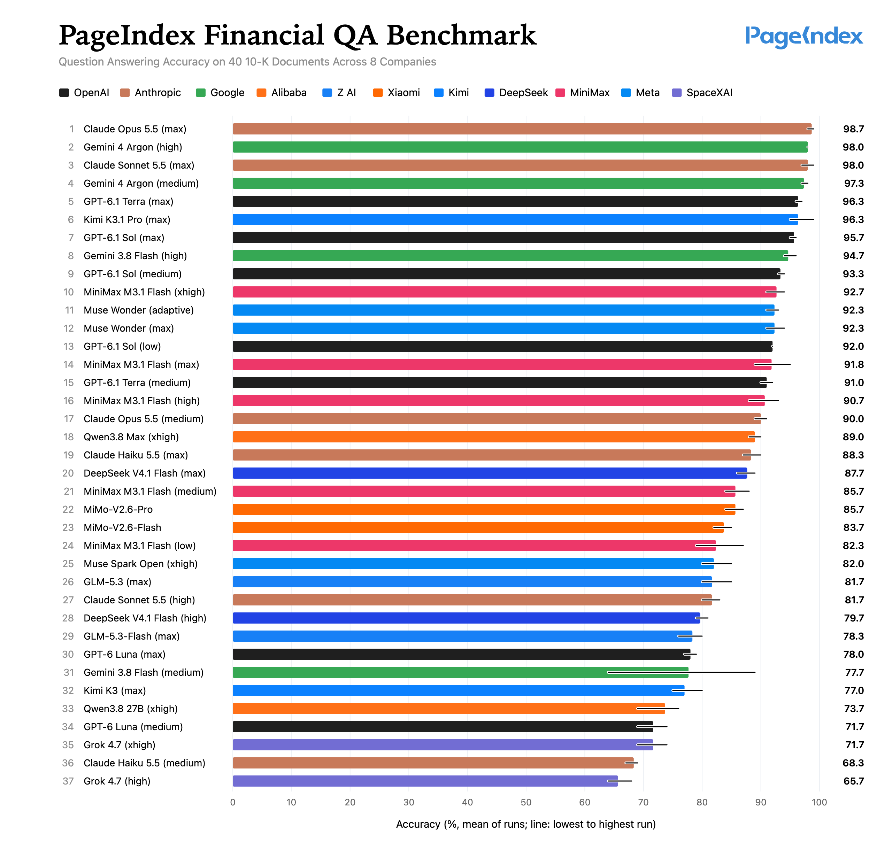

# PageIndex Financial QA Benchmark

37 configurations of 21 LLMs, each answering the same 100 questions about 40 annual reports (Form 10-K) of eight
companies, with PageIndex doing the retrieval. The questions are hard for retrieval: they name the company and year
but not where the answer is, and ask for every item of a kind without saying how many there are. Every
configuration ran at least three times and was graded blind; cost is what OpenRouter billed. All answers, model
calls, bills and grades are in this folder, and every number below can be recomputed from them.

**Accuracy**



**Accuracy vs. cost**


## Findings

- **Most accurate**: Claude Opus 5.5 (max), 98.7% at $128.49 per 100-question run, and Gemini 4 Argon (high),
  98.0% at $29.27; the two differ on 5 questions (3 : 2). Gemini 4 Argon (medium) reaches 97.3% for $24.13.
- **Low cost**: MiniMax M3.1 Flash (xhigh) answers 92.7% at $3.18 per run, a point below GPT-6.1 Sol (medium),
  93.3% at $20.09 (17 : 7 questions, sign test p = 0.06). MiMo-V2.6-Flash, 83.7% at $1.47, is the cheapest point
  on the accuracy-vs-cost chart's Pareto line.
- **Reasoning level**: raising it lifts some models a lot: Claude Sonnet 5.5 from 81.7% (high) to 98.0% (max),
  Claude Haiku 5.5 from 68.3% to 88.3%, Gemini 3.8 Flash from 77.7% to 94.7%, DeepSeek V4.1 Flash from 79.7% to
  87.7% (each p < 0.01). For GPT-6.1 Sol (low 92.0%, medium 93.3%, max 95.7%), Gemini 4 Argon and Muse Wonder the
  levels are within noise of each other.

## Results

| # | Model | Reasoning | Accuracy (%) | Runs | SET (52) | WHY (28) | XCO (20) | $ per run | Pareto |
|---|---|---|---|---|---|---|---|---|---|
| 1 | Claude Opus 5.5 | max | 98.7 | 98/99/99 | 100.0 | 95.2 | 100.0 | 128.49 | ✓ |
| 2 | Gemini 4 Argon | high | 98.0 | 98/98/98 | 100.0 | 92.9 | 100.0 | 29.27 | ✓ |
| 3 | Claude Sonnet 5.5 | max | 98.0 | 99/98/97 | 98.7 | 95.2 | 100.0 | 65.76 |  |
| 4 | Gemini 4 Argon | medium | 97.3 | 97/97/98 | 100.0 | 90.5 | 100.0 | 24.13 | ✓ |
| 5 | GPT-6.1 Terra | max | 96.3 | 96/96/97 | 95.5 | 95.2 | 100.0 | 17.81 | ✓ |
| 6 | Kimi K3.1 Pro | max | 96.3 | 95/95/99 | 98.1 | 91.7 | 98.3 | 32.09 |  |
| 7 | GPT-6.1 Sol | max | 95.7 | 96/96/95 | 98.1 | 88.1 | 100.0 | 34.36 |  |
| 8 | Gemini 3.8 Flash | high | 94.7 | 96/94/94 | 94.9 | 92.9 | 96.7 | 25.59 |  |
| 9 | GPT-6.1 Sol | medium | 93.3 | 94/93/93 | 94.9 | 85.7 | 100.0 | 20.09 |  |
| 10 | MiniMax M3.1 Flash | xhigh | 92.7 | 94/93/93/93/91/92 | 93.9 | 85.7 | 99.2 | 3.18 | ✓ |
| 11 | Muse Wonder | adaptive | 92.3 | 93/91/93 | 91.7 | 90.5 | 96.7 | 53.75 |  |
| 12 | Muse Wonder | max | 92.3 | 92/94/91 | 92.3 | 88.1 | 98.3 | 104.38 |  |
| 13 | GPT-6.1 Sol | low | 92.0 | 92/92/92 | 92.9 | 84.5 | 100.0 | 18.26 |  |
| 14 | MiniMax M3.1 Flash | max | 91.8 | 90/91/94/95/92/89 | 94.6 | 83.9 | 95.8 | 3.24 |  |
| 15 | GPT-6.1 Terra | medium | 91.0 | 91/90/92 | 92.3 | 84.5 | 96.7 | 11.80 |  |
| 16 | MiniMax M3.1 Flash | high | 90.7 | 91/88/93 | 91.7 | 82.1 | 100.0 | 3.10 | ✓ |
| 17 | Claude Opus 5.5 | medium | 90.0 | 91/90/89 | 90.4 | 84.5 | 96.7 | 65.79 |  |
| 18 | Qwen3.8 Max | xhigh | 89.0 | 88/90/89 | 87.2 | 85.7 | 98.3 | 31.04 |  |
| 19 | Claude Haiku 5.5 | max | 88.3 | 88/87/90 | 90.4 | 77.4 | 98.3 | 15.20 |  |
| 20 | DeepSeek V4.1 Flash | max | 87.7 | 89/88/86 | 85.3 | 85.7 | 96.7 | 3.43 |  |
| 21 | MiniMax M3.1 Flash | medium | 85.7 | 85/84/88 | 85.3 | 81.0 | 93.3 | 2.62 | ✓ |
| 22 | MiMo-V2.6-Pro | – | 85.7 | 86/84/87 | 82.7 | 83.3 | 96.7 | 3.81 |  |
| 23 | MiMo-V2.6-Flash | – | 83.7 | 82/84/85 | 79.5 | 86.9 | 90.0 | 1.47 | ✓ |
| 24 | MiniMax M3.1 Flash | low | 82.3 | 81/79/87 | 82.7 | 75.0 | 91.7 | 2.12 |  |
| 25 | Muse Spark Open | xhigh | 82.0 | 80/81/85 | 84.0 | 78.6 | 81.7 | 22.86 |  |
| 26 | GLM-5.3 | max | 81.7 | 85/80/80 | 82.1 | 79.8 | 83.3 | 17.57 |  |
| 27 | Claude Sonnet 5.5 | high | 81.7 | 82/80/83 | 85.9 | 67.9 | 90.0 | 30.89 |  |
| 28 | DeepSeek V4.1 Flash | high | 79.7 | 79/79/81 | 76.9 | 78.6 | 88.3 | 2.47 |  |
| 29 | GLM-5.3-Flash | max | 78.3 | 80/79/76 | 77.6 | 73.8 | 86.7 | 1.86 |  |
| 30 | GPT-6 Luna | max | 78.0 | 77/78/79 | 73.1 | 78.6 | 90.0 | 2.27 |  |
| 31 | Gemini 3.8 Flash | medium | 77.7 | 89/80/64 | 84.0 | 83.3 | 53.3 | 10.16 |  |
| 32 | Kimi K3 | max | 77.0 | 80/76/75 | 76.3 | 71.4 | 86.7 | 30.28 |  |
| 33 | Qwen3.8 27B | xhigh | 73.7 | 76/76/69 | 75.0 | 57.1 | 93.3 | 7.68 |  |
| 34 | GPT-6 Luna | medium | 71.7 | 69/72/74 | 72.4 | 64.3 | 80.0 | 1.46 | ✓ |
| 35 | Grok 4.7 | xhigh | 71.7 | 74/69/72 | 76.9 | 64.3 | 68.3 | 40.97 |  |
| 36 | Claude Haiku 5.5 | medium | 68.3 | 69/67/69 | 62.8 | 59.5 | 95.0 | 6.46 |  |
| 37 | Grok 4.7 | high | 65.7 | 64/65/68 | 67.9 | 63.1 | 63.3 | 33.33 |  |

- **Reasoning**: the level the model ran at; – for models without levels ([METHOD.md](METHOD.md#configurations)).
- **Accuracy**: mean over runs; an answer counts only if it covers every key point and contradicts nothing.
  **Runs**: each run's score out of 100.
- **SET, WHY, XCO**: accuracy by question type (open set, open causes, cross-company open set), with the number of
  questions.
- **$ per run**: what OpenRouter billed for one run of the 100 questions, mean over runs ([METHOD.md](METHOD.md#cost));
  building the index is a one-time cost and not included.
- **Pareto**: no other configuration is cheaper and at least as accurate. The accuracy-vs-cost chart leaves out five
  configurations to declutter, so its Pareto line differs.

Generated by `python3 results.py` into [results/results.md](results/results.md); per run in
[results/runs.csv](results/runs.csv).

## Reproduce

Python 3.9 or later. Checking the results needs only the standard library and no API key:

```bash
cd financial-qa
python3 results.py                  # the table, runs.csv and the charts' SVGs, from data/
git diff --stat results/            # no change: the results come out as committed
python3 grade.py report round1      # one grading round: accuracy per run, grader agreement
python3 results.py compare gpt-6.1-sol-medium minimax-m3.1-flash-xhigh
```

Each PNG is its SVG rendered by a headless browser (command in `results.py`).

Running a configuration calls models through OpenRouter and is billed to your key. Add it as a row in
[models.py](models.py), then:

```bash
python3 -m venv .venv && . .venv/bin/activate
pip install -r requirements.txt     # pins pageindex==0.4.4
export OPENROUTER_API_KEY=...
python3 run.py preflight CONFIG     # route, standard-tier price, reasoning setting
python3 run.py answer CONFIG 1      # one run of the 100 questions
```

- Runs write to `data/`. Prices and model behavior change over time, so a new run of a configuration listed here
  need not match its results; give it a new run number (4, 5, ...) to keep the existing runs.
- Grading new runs: [grading/README.md](grading/README.md).
- The library and the 40 PDFs are included. To rebuild the library, move `library-w70/` aside, then
  `python3 corpus/fetch.py` (checks the PDFs) and `python3 index.py`; a rebuilt library differs from this one, and
  runs record which they used.

## Layout

```
financial-qa/
├── README.md, METHOD.md      results, and how they were made
├── models.py                 the 37 configurations: route, provider, reasoning level
├── run.py                    answer the questions through PageIndex and OpenRouter
├── grade.py                  blind grading sheets, and the grades graders return
├── results.py                table, CSV, chart and comparisons from data/
├── index.py                  build the library from the filings
├── questions/questions.json  the 100 questions, reference answers, key points, evidence pages
├── corpus/                   the 40 filings (pdfs/), manifest, checksums, check script
├── library-w70/              the PageIndex library every configuration answers from
├── grading/                  the graders' rubric and setup
├── data/                     answers, calls, OpenRouter records, runs, preflight checks, grades (data/README.md)
└── results/                  generated by results.py
```
