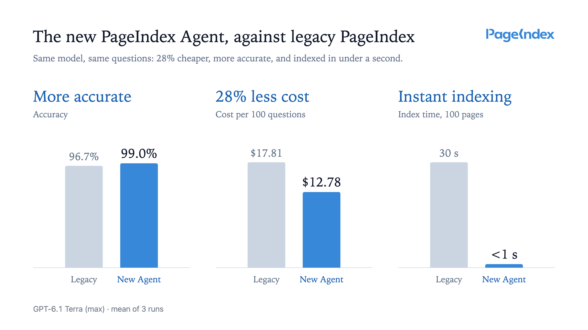

# The new PageIndex Agent, against legacy PageIndex

The same model on the same questions, [Financial QA](../financial-qa/README.md)'s 100 questions about 40 Form 10-K
filings, answered by

- **legacy PageIndex** (PageIndex 0.4.4): the agent over a local library, with text tools, as in Financial QA;
- **the new PageIndex Agent** (PageIndex 0.7.0): the filings indexed on PageIndex Cloud, and the agent with the
  cloud's tools, which search across documents and pages and read pages as text or images.

Every run was graded blind on Financial QA's rubric. All answers, model calls, bills and grades are in this folder
and `../financial-qa/data/`, and every accuracy and cost below can be recomputed from them; the chart's index time
is PageIndex's figure ([METHOD.md](METHOD.md#index-time)).



## Results

| Configuration | PageIndex | Accuracy (%) | Runs | SET (52) | WHY (28) | XCO (20) | $ model calls | $ PageIndex search | $ per run |
|---|---|---|---|---|---|---|---|---|---|
| GPT-6.1 Terra (max) | legacy, 0.4.4 | 96.7 | 96/97/97 | 96.2 | 95.2 | 100.0 | 17.81 | – | 17.81 |
| GPT-6.1 Terra (max) | new agent, 0.7.0 | 99.0 | 100/99/98 | 99.4 | 97.6 | 100.0 | 9.81 | 2.97 | 12.78 |

- On the new agent, GPT-6.1 Terra (max) is 28% cheaper per run and answers 4 questions more often right and 1
  less often (paired p = 0.31, [../financial-qa/METHOD.md](../financial-qa/METHOD.md#statistics)).
- **$ model calls**: what OpenRouter billed. **$ PageIndex search**: what PageIndex charges for the agent's searches
  at its list prices ([METHOD.md](METHOD.md#cost)). Indexing the filings is a one-time cost and not included.

Generated by `python3 compare.py` into [results/results.md](results/results.md), with the chart's SVG.

## Reproduce

Checking the results needs only the standard library and no API key:

```bash
cd new-agent-vs-legacy
python3 compare.py                  # results/results.md, from data/ and ../financial-qa/data/
git diff --stat results/            # no change
```

Running a configuration is billed by OpenRouter (the model) and PageIndex (indexing and searches):

```bash
python3 -m venv .venv && . .venv/bin/activate
pip install -r requirements.txt     # pins pageindex==0.7.0
export OPENROUTER_API_KEY=... PAGEINDEX_API_KEY=...
python3 upload.py                   # the 40 filings into a collection named financial-qa
python3 run.py preflight CONFIG     # as ../financial-qa/run.py
python3 run.py answer CONFIG 1      # one run of the 100 questions
```

PageIndex Cloud changes with the product (its tools, the agent's prompt), so a new run need not match these; each
run records what it ran on.

## Layout

```
new-agent-vs-legacy/
├── README.md, METHOD.md   results, and how they were made
├── upload.py              the 40 filings into a PageIndex Cloud collection
├── run.py                 answer the questions on it, using ../financial-qa/run.py for calls and preflight
├── compare.py             results/results.md and the chart: the new agent against legacy
├── data/                  as ../financial-qa/data/ (its README), and collection.json
└── results/               generated by compare.py
```

An answer row here also has `tools` (calls per tool), `searches` (each priced search: tool, questions, pages or
documents read, USD), `pageindex_usd` (their sum) and `pictures` (page images the agent received).
